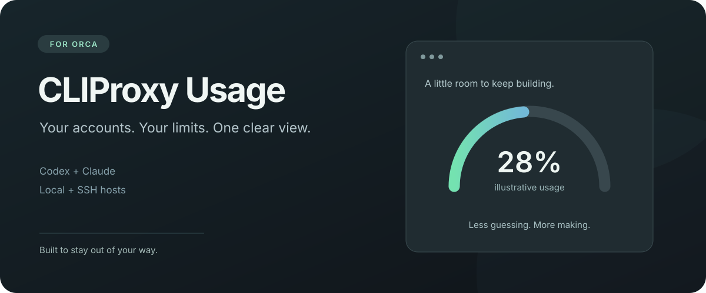
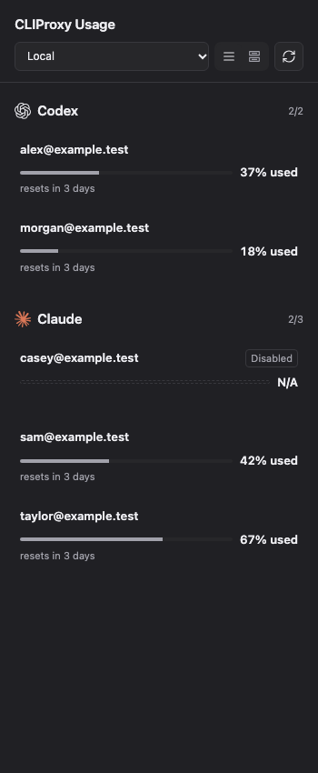
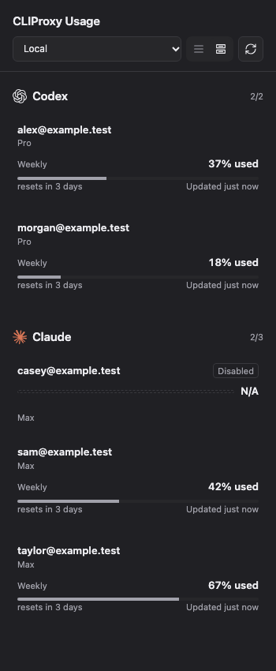
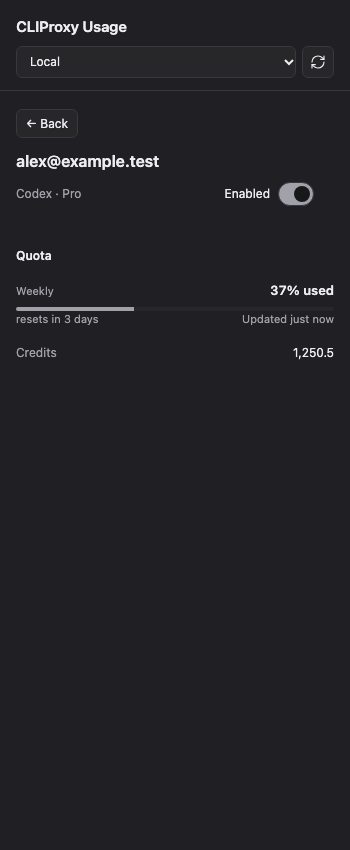

<div align="center">
  
  <p>
    <a href="LICENSE"></a>
    
    
  </p>
  <p><strong>Keep Codex and Claude usage close to your work.</strong><br>One themed Orca panel. Local and SSH hosts. Clear limits, without the dashboard detour.</p>
</div>

## A clear view of every account

Switch between a compact scan and detailed quota windows. Open an account for its plan, credits, reset information and Enabled control. Two status items keep the current account usage and reset time within reach.

<table>
<tr><th>Compact</th><th>Detailed</th><th>Account details</th></tr>
<tr>
<td></td>
<td></td>
<td></td>
</tr>
</table>

*Screenshots use fictional accounts and simulated usage. No account credentials or real usage are included.*

- **Choose the host explicitly.** Each remote reads its own config and talks to its own proxy.
- **See useful detail.** Available/total credential counts, quota windows, plans, credits and resets when the proxy provides them.
- **Stay oriented.** Theme colors follow Orca; keyboard navigation, visible focus and Back preserve your place.
- **Keep working during refresh.** Prior data stays visible. Missing quota stays `N/A`; a measured zero is `0%`.
- **Change Enabled deliberately.** Confirmed state is read back; uncertain results are reconciled without repeating the write.

Status usage belongs to one automatically chosen account, not a provider-wide average. Available credentials are preferred; when none are available, one unavailable account is shown with its state. Fresh usable quota comes first, then older observations, then accounts without quota. The tooltip identifies the account. Selection does not change proxy routing.

## Install

Requires **Orca desktop 1.4.258+ on macOS**, `/usr/bin/python3` 3.9+ on each collection host, and a compatible CLIProxy management API (`/v0/management`). SSH profiles also need noninteractive SSH with a trusted host key. This version reads **JSON-formatted configuration**, even if the filename ends in `.yaml`; general YAML is not supported.

Once the public repository is available, run:

```fish
orca plugin install shumkov/orca-cliproxy-usage@v0.1.0 --json
```

Orca returns an approval request for this exact source and access. Review it, then rerun the command with `--approve` and **the fingerprint Orca returned**. Do not copy another person's fingerprint. You can also install the repository through Orca's plugin UI when its listing is available.

Open **CLIProxy: Open Usage** in the command palette, or click either status item. A Git install is named `shumkov.cliproxy-usage`; a folder install is named `local.cliproxy-usage`.

```fish
orca plugin open shumkov.cliproxy-usage --panel usage --json
orca plugin update shumkov.cliproxy-usage --json
```

## Connect your hosts

In **Settings → Plugins → CLIProxy Usage**, edit **Connection profiles** as a JSON array. A new install has a Local profile and waits for you to select a host in the panel. Replace the examples with your paths and SSH alias; never put a key or token in these settings.

```json
[
  {
    "id": "local",
    "label": "Local",
    "transport": "local",
    "configPath": "~/.cli-proxy-api/config.yaml",
    "baseUrl": "http://127.0.0.1:8318"
  },
  {
    "id": "remote",
    "label": "Development",
    "transport": "ssh",
    "target": "user@proxy.example.test",
    "configPath": "~/.cli-proxy-api/config.yaml",
    "baseUrl": "http://127.0.0.1:8318"
  }
]
```

Paths and loopback addresses are interpreted **on the selected host**. Your SSH alias can define its key and connection settings in `~/.ssh/config`. SSH uses batch mode and strict host-key checking; establish trust yourself before using the profile.

The collector reads `remote-management.secret-key` from the host's JSON config. If that value is a stored hash rather than the plaintext management key, add `"secretPath": "~/.config/cliproxy/management-key"` to that profile. The file must contain only the plaintext key; restrict its permissions to its owner. Keep both config and key file on that host. The plugin never changes proxy configuration.

## What the numbers mean

**2/3** means two available credential entries out of three, as reported by proxy state. Duplicate authorizations count separately. Disabled, sign-in requirements, limits and cooldowns can affect availability independently of the displayed usage percentage.

**N/A** means that a usable quota value has not been returned. It does not mean zero, exhaustion or a connection failure. Older observations keep their update age; a passed reset says it is awaiting an update. Failed refreshes retain the last data and show a connection notice.

The plugin reads quota and entitlement information when supported. It does not purchase credits, consume resets, generate completions, select proxy routing, add authorizations or delete them.

## Security and access

This is a **trusted-worker plugin**, not a sandboxed data theme. Approval allows its worker to run Node processes, read selected-host files and use SSH/network access with your user privileges. The declared Orca API grants are `storage:own` and `settings:own`; those grants do not sandbox the trusted worker. Install only source you trust.

Management keys stay on their host and are never sent to the panel. Provider tokens are not stored in plugin settings. Journals, selected host and display mode use plugin-owned storage. The collector uses literal loopback management URLs, fixed process arguments, bounded output and timeouts. Logs contain bounded categories rather than raw configuration, tokens or SSH stderr. A rejected management key is not retried automatically; correct it and choose **Retry connection**.

An Enabled change is sent once, then verified. If its response is lost, the switch stays uncertain until authoritative readback resolves it. Do not interpret an unconfirmed change as success or repeatedly click to resend it. See [architecture and safety](docs/ARCHITECTURE.md).

## Troubleshooting

| Symptom | Check |
| --- | --- |
| `N/A` | The management API may not expose quota for that account. Open it to request supported detail; missing data remains `N/A`. |
| Checking accounts | The first account read is pending. If it fails, the panel shows an error rather than an empty account list. |
| Connection unavailable | Check that the host is reachable, Python exists, and the proxy is listening on the configured loopback port. For SSH, verify noninteractive access and trusted host keys. |
| Authentication failed | Correct the management key on that host, then use Retry connection. A provider sign-in warning is a separate condition. |
| Enabled unavailable | Wait for an authoritative credential read, or resolve the displayed authentication/identity/uncertain-write notice. Quota refresh alone does not lock the switch. |
| Panel does not open | Run the command above for the installed key. If identical local and Git installations coexist, remove the unused copy; ambiguous identities are refused. |

Provider marks are shown in the panel. Orca's current status API accepts a fixed icon set, so status items retain provider names rather than custom logos. Some management responses omit plan/credit/reset fields; empty optional fields are hidden. General YAML, Windows/Linux Orca collection and authorization management are not implemented. Connection failures can still occur; the plugin preserves cached observations and reports failures without claiming a cause it cannot establish.

## Roadmap

- [ ] Add authorizations through a supported sign-in flow.
- [ ] Delete authorizations with an explicit confirmation and verified result.
- [ ] Broaden configuration-format and platform compatibility.

Authorization add/remove is **planned, not shipped**. Follow or propose work in [Issues](https://github.com/shumkov/orca-cliproxy-usage/issues).

## Development

Use Node.js 24+ for the TypeScript scripts/tests and install Chromium for headless UI checks.

```fish
npm ci
npx playwright install chromium
orca plugin types . --json
npm run typecheck
npm test
npm run test:ui
orca plugin test . --json
orca plugin validate . --json
npm run package
orca plugin inspect .orca/package --json
```

Tests use local fake management servers and a strict mock frame bridge, including persisted Enabled state, held responses and an applied PATCH with a lost response. They do not require real provider accounts. `orca plugin check .` validates the package and statically checks contributions; HTML interaction/rendering is tested separately with headless Chromium. No CI status is claimed by the badges above.

A clean repository checkout is installable directly (before adding development dependencies); `.orca/package` is a smaller runtime package. Neither requires `node_modules` to run. `npm run screenshots` regenerates the synthetic README images using the same headless frame fixture as the UI tests.

## License and credits

Owned code and original artwork are [MIT licensed](LICENSE). Bundled provider marks retain [upstream MIT attribution and trademark notices](docs/PROVIDER_MARKS_NOTICE.md). OpenAI and Anthropic do not endorse this plugin.
